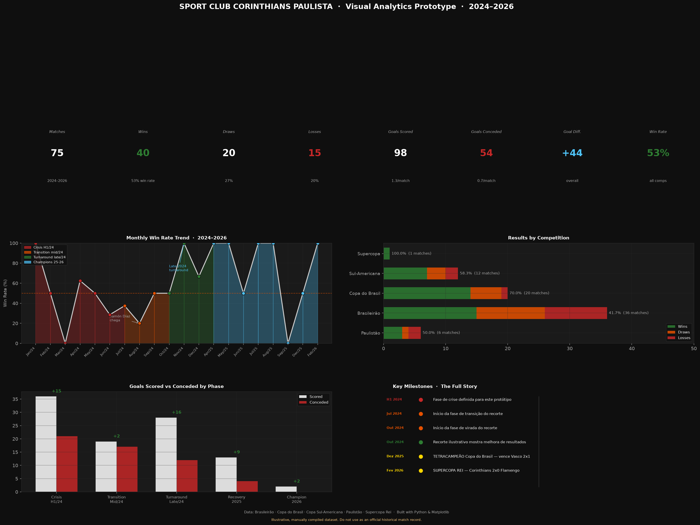

# Corinthians Performance Analytics — visual prototype

[](https://github.com/Willian-Yudy-F/corinthians-performance-analytics/actions/workflows/ci.yml)



A Python and Matplotlib prototype for exploring how a football performance story can be presented in a single executive dashboard.

## Important data note

The 75 match rows inside `corinthians_dashboard.py` were manually compiled for visual experimentation. They do not have row-level citations and several historical fields have not been audited against an official match database. The calculated KPIs therefore describe the **included sample**, not an authoritative Corinthians record.

This limitation is now printed on the dashboard itself. The project should be assessed for its data transformation and visual design, not used as a source for sporting statistics.

Two headline milestones are independently supported by official CBF reports:

- Corinthians won the 2025 Copa do Brasil after a 0–0 first leg and a 2–1 win over Vasco in the final match: [CBF report](https://www.cbf.com.br/futebol-brasileiro/noticias/copa-brasil-masculino/a/corinthians-vence-vasco-e-conquista-seu-quarto-titulo-da-copa-do-brasil).
- Corinthians won the 2026 Supercopa Rei 2–0 against Flamengo: [CBF report](https://www.cbf.com.br/futebol-brasileiro/noticias/supercopa-do-brasil/profissional/corinthians-vence-flamengo-e-conquista-supercopa-rei-superbet-2026).

## What the code demonstrates

- conversion of match rows into a pandas DataFrame;
- derived result, goal-difference, phase and monthly fields;
- aggregation by month, competition and project-defined phase;
- a multi-panel Matplotlib layout with KPIs, trends, bars and milestones;
- headless image generation suitable for CI.

## Run locally

```bash
python -m venv .venv
source .venv/bin/activate
pip install -r requirements.txt
python corinthians_dashboard.py
```

The command writes `corinthians_dashboard_2024_2026.png` beside the script. A different path can be supplied:

```bash
python corinthians_dashboard.py --output output/dashboard.png
```

## Quality checks

```bash
python -m unittest discover -s tests -v
python corinthians_dashboard.py --output /tmp/corinthians-dashboard.png
```

CI runs the tests and renders a fresh dashboard on Python 3.11 and 3.13.

## Next improvement

Replace the embedded sample with a CSV whose every row records its competition, official source URL and retrieval date. Only then should the dashboard present its KPIs as historical findings or make causal claims about coaches and players.
